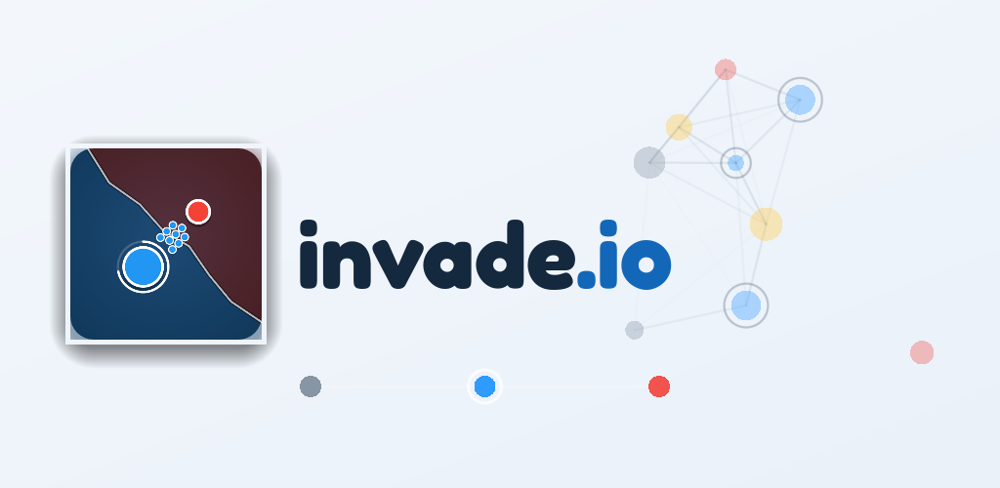
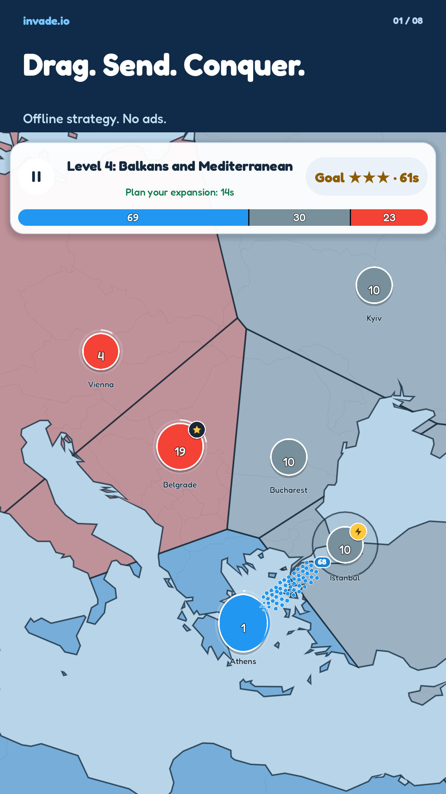
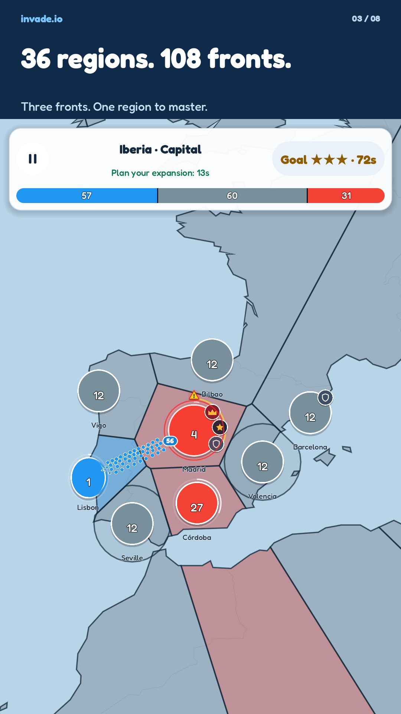
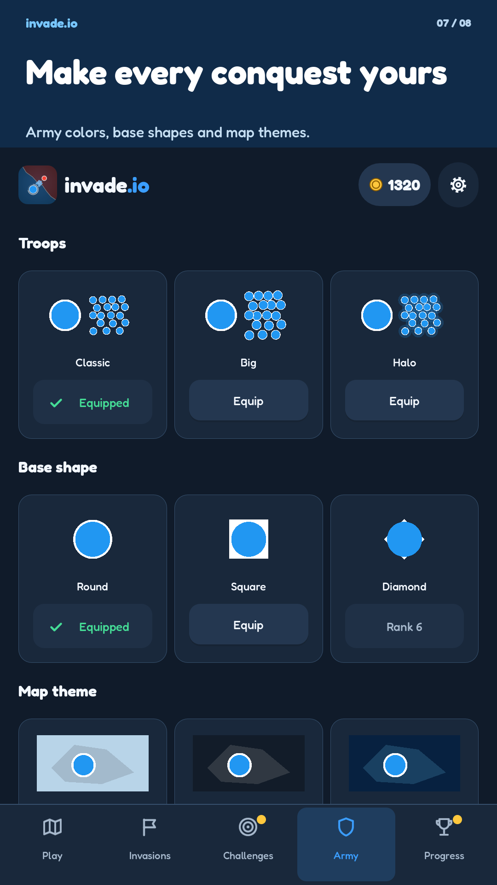

# invade.io

**Territory strategy on real-world maps. Built with Godot. Open to everyone.**

Drag between bases, coordinate your troops, and turn a foothold into a continental
conquest. invade.io is an open-source, single-player strategy game with offline
gameplay, no ads, and no in-app purchases.

[**Play on Google Play**](https://play.google.com/store/apps/details?id=macarronesc.invadeio)
· [Documentation](docs/README.md)
· [Run locally](#run-locally)
· [Contribute](CONTRIBUTING.md)



## Drag. Send. Conquer.

Simple controls leave room for tactical decisions. Chain friendly bases into a
combined attack, capture factories to recruit faster, break through fortresses,
or cut a marching route to retreat before your troops arrive.

<p align="center">
  <a href="docs/store_assets/screenshots_en/1_conquer.png"></a>
  <a href="docs/store_assets/screenshots_en/3_invasions.png"></a>
  <a href="docs/store_assets/screenshots_en/7_cosmetics.png"></a>
</p>

*Real game scenes with representative mid-game progress. Select an image to view
it at full size. More about the [gameplay](docs/GAMEPLAY.md) and
[reproducible captures](docs/PLAY_STORE_UPDATE.md).*

## More territory to discover

- **A six-continent campaign.** Play 30 levels with capitals, factories, jungle,
  oases, fortresses, sea routes, and bosses with reinforcements.
- **Regional invasions.** Unlock 36 regions and 108 fronts by completing each
  continent's campaign. Earn stars, master regions, and unlock army colors.
- **Expeditions and daily challenges.** Explore five-region expeditions or take on
  a locally generated daily challenge without combat upgrades. Share a result
  card—not a live multiplayer match.
- **Progress earned by playing.** Upgrade your army, climb the ranks, collect
  cities in the atlas, complete 20 achievements, and unlock cosmetic styles.
- **Play your way.** Choose from 15 languages, including an Arabic right-to-left
  interface, light/dark themes, text sizes, a color-blind palette, reduced motion,
  map contrast, game speeds, and adjustable haptics.
- **Offline, with local saves.** No account is required. Export and restore a
  backup from Settings; there is no cloud save or online leaderboard.

These features describe the current source. Store availability and the installed
release may differ; see [project status](docs/README.md#project-status).

## Run locally

Use the **standard Godot 4.7.2 editor**; this is a GDScript project, so .NET is not
required. Export templates, Android tools, Apple credentials, and a backend are
not needed to run it on a supported development platform.

```sh
git clone --branch dev https://github.com/macarronesc/invade.io.git
cd invade.io
godot --headless --path . --editor --import
godot --path . -- --no-telemetry
```

The first launch starts the tutorial battle. Mouse dragging emulates touch on
desktop. The command above disables telemetry for that run; ordinary gameplay
from the editor can send usage/crash data under the saved privacy settings.

For setup, supported environments, and troubleshooting, read the
[development guide](docs/DEVELOPMENT.md). For checks to run before submitting a
change, see [testing](docs/TESTING.md).

## Build the game with us

invade.io brings geographic map generation, deterministic enemy decisions,
mobile-oriented interfaces, multilingual typography, procedural audio, and local
save recovery together in a playable Godot project. Its tests and store captures
are part of the repository, so contributors can inspect and reproduce the work.

You can help with gameplay, regression tests, UI and accessibility, translation
review, device testing, or documentation. Start with the
[contribution guide](CONTRIBUTING.md), browse the
[issues](https://github.com/macarronesc/invade.io/issues), or use the
[codebase map](docs/ARCHITECTURE.md#where-to-make-a-change) to find your way around.
Contribution PRs target **`dev`**; release PRs target `main`.

| Looking for… | Start here |
|---|---|
| Controls, game modes, and progression | [Gameplay guide](docs/GAMEPLAY.md) |
| Setup, localization, and asset workflows | [Development guide](docs/DEVELOPMENT.md) |
| Systems and source-file responsibilities | [Architecture](docs/ARCHITECTURE.md) |
| Automated checks and manual QA | [Testing](docs/TESTING.md) |
| Android builds and iOS/SideStore testing | [Platform integration](docs/PLATFORM_INTEGRATION.md) |
| Signing and release maintenance | [Release guide](docs/RELEASES.md) |

## Privacy and support

Gameplay works without an internet connection. In the current source, optional
usage statistics (Aptabase) and crash reports (Sentry) are **enabled by default**;
saved choices are respected, and either option can be disabled separately in
**Settings → Privacy**. See [telemetry documentation](docs/ANALYTICS.md) and the
[public privacy policy](https://macarronesc.github.io/invade.io/privacy-policy.html).
The published policy must match the installed release, not an unreleased checkout.

Report bugs through [GitHub issues](https://github.com/macarronesc/invade.io/issues)
with your version, device, and reproduction steps. Report vulnerabilities
[privately](SECURITY.md), never in a public issue. Player support:
[alegandro2507@gmail.com](mailto:alegandro2507@gmail.com).

## License and credits

First-party code and assets are available under [Apache-2.0](LICENSE).
[NOTICE](NOTICE) credits **macarronesc** as the original author and records the
attribution to preserve when redistributing the original or derivative code.
Commercial use and proprietary derivatives are permitted under the license.

Third-party components retain their own licenses: Aptabase and Sentry (MIT),
Fredoka/Noto fonts (OFL), and Natural Earth geography (public domain). The game
includes an offline license viewer in Settings; see the
[bundled notices](assets/legal/notices.txt) for details.
