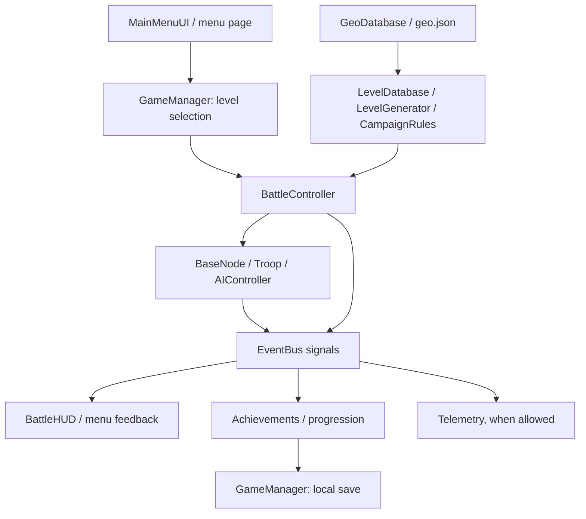

# Architecture and source map

[Documentation](README.md) · [Development](DEVELOPMENT.md) · [Testing](TESTING.md)

invade.io is a Godot 4.7.2 GDScript project using the GL Compatibility renderer.
Scenes provide the game entry points; scripts build most interface controls and
implement gameplay. There is no game server, account system, or online authority.

## Repository layout

| Path | Responsibility |
|---|---|
| [project.godot](../project.godot) | Main scene, autoloads, rendering, display settings, translations, and source version |
| [scenes/](../scenes/) | Menu, battle, HUD, base scene, and executable test scenes |
| [scripts/autoload/](../scripts/autoload/) | Shared state, signals, audio, achievements, telemetry, and toasts |
| [scripts/battle/](../scripts/battle/) | Battle orchestration, base/troop behavior, AI, territory rendering, and tutorial |
| [scripts/data/](../scripts/data/) | Content catalogs, geographic generation, rules, rewards, ranks, and localization helpers |
| [scripts/ui/](../scripts/ui/) | Menu pages, battle HUD, settings, shared theme, and icons |
| [assets/](../assets/) and [locale/](../locale/) | Checked-in geography, fonts, brand/legal assets, and translations |
| [addons/](../addons/) and [ios/plugins/](../ios/plugins/) | Vendored telemetry SDKs and the native iOS backup picker |
| [tools/](../tools/) and [scripts/](../scripts/) | Authoring, validation, platform build, and artifact-verification tools |
| [.github/workflows/](../.github/workflows/) | CI, isolated signing, releases, and privacy-policy deployment |

## From menu to saved progress

In words: a menu chooses the level, the data layer constructs its map and rules,
the battle advances bases/troops/AI, and result signals update the UI and player
progress. `GameManager` persists local state; telemetry observes selected events
only when permitted. Not all state changes go through `EventBus`—some systems
call `GameManager` directly.

### Entry points and autoloads

[main_menu.tscn](../scenes/ui/main_menu.tscn) is the project entry scene. On a new
save, [MainMenuUI](../scripts/ui/main_menu.gd) starts `europe_1` immediately;
subsequent visits build the selected menu page. `UIThemeHelper.start_battle()`
selects the level and switches to
[battle_field.tscn](../scenes/battle/battle_field.tscn).

Autoload order is declared in `project.godot`:

| Autoload | Role |
|---|---|
| `EventBus` | Shared battle, reward, economy, appearance, and settings signals |
| `GameManager` | Current selection, player progress, economy, settings, validation, and persistence |
| `AudioManager` | Synthesized sound/music playback, volume settings, and lifecycle suspension |
| `AchievementManager` | Observes battle signals, updates statistics, XP/missions, and achievement unlocks |
| `Toasts` | Brief notifications outside individual pages |
| `Aptabase` | Vendored analytics client; provider initialization is controlled by `Telemetry` |
| `Telemetry` | Usage/crash integration, privacy gates, and event context |

### Levels, rules, and geography

[LevelDatabase](../scripts/data/level_database.gd) routes campaign, `inv_…`,
`conquest_…`, and `daily_…` identifiers to their definitions. Built levels are
cached by identifier, language, and orientation.

`LevelDatabase.mode_of()` is the shared mode classifier. Campaign labels use
`level_name()` without constructing geography; `get_level_ids()` returns a cached,
read-only campaign order (duplicate it before extending a list).

- [InvasionDatabase](../scripts/data/invasion_database.gd) describes regions and
  constructs three fronts per region.
- [LevelGenerator](../scripts/data/level_generator.gd) builds deterministic maps,
  projects real city coordinates, separates bases for interaction, adds eligible
  neutral cities, and clips the visible geography.
- [CampaignRules](../scripts/data/campaign_rules.gd) applies continent/region
  properties, connected sea routes, bosses, and daily holding objectives.
- [GeoDatabase](../scripts/data/geo_database.gd) loads
  [geo.json](../assets/data/geo.json) on demand. [MapProjection](../scripts/data/map_projection.gd)
  handles Mercator projection; [TerritoryMap2D](../scripts/battle/territory_map_2d.gd)
  draws political geography and territorial cells.

Difficulty and AI cadence come from `LevelDatabase.get_balance()`, not the
player's upgrade purchases. Orientation changes preserve content and rules;
daily challenges keep a canonical board for comparable records. A seeded
scenario is not a guarantee of identical rendered pixels across GPUs/fonts.

### Battle simulation

[BattleController](../scripts/battle/battle_controller.gd) loads the level,
instantiates bases and enemy controllers, accepts gestures, dispatches orders,
and evaluates battle outcomes. It advances troop packets, resolves collisions,
then resolves arrivals, so a large frame step cannot simply skip a crossing fight.

[BaseNode](../scripts/battle/base_node.gd) owns production, capacity, defense,
captures, and base presentation. [Troop](../scripts/battle/troop.gd) represents an
order split into packets, including delayed departure, retreat, and source-loss
behavior. [AIController](../scripts/battle/ai_controller.gd) uses seeded decisions,
projected defense, incoming-force estimates, and faction archetypes. Player and
AI dispatches share the battle controller's route checks.

Orders are plain `Troop.new()` nodes. Movement and both arrival previews share
the troop arrival formula. Formation offsets and closed territory outlines are
prepared once and reused; they do not change simulation timing or rendering.
`GameManager.victory_rewards()` owns mode-specific economy/progression, while
the battle controller still decides the outcome and emits the same result events.

The [BattleHUD](../scripts/ui/battle_hud.gd) handles briefing/HUD, pause/help,
alternate accessible controls, and results. The
[tutorial overlay](../scripts/battle/tutorial_overlay.gd) guides early interactions.

### UI and localization

The five main-menu pages are registered in `MainMenuUI.TABS`. Scrolling pages
inherit [ScrollPage](../scripts/ui/scroll_page.gd), implement `_build()`, and
rebuild after economy changes. Play uses its own responsive map/briefing layout.

[UIThemeHelper](../scripts/ui/ui_theme_helper.gd) centralizes palettes, typography,
theme variations, reusable controls, safe areas, scaling, and scene transitions.
[Icons](../scripts/ui/icons.gd) provides the shared SVG icon set. Use these rather
than duplicating styling inside new pages.

[LocaleStrings](../scripts/data/locale_strings.gd) resolves translation keys;
[LanguageCatalog](../scripts/data/language_catalog.gd) defines locale normalization,
font scripts, and RTL direction. Translations and geographic names feed the font
subset tools. See the [localization workflow](DEVELOPMENT.md#localization).

### Persistence, lifecycle, and privacy

`GameManager` saves a versioned JSON document (currently format 7), with field
validation, temporary-file replacement, a `.previous` recovery copy, future-format
protection, and confirmed manual import with a `.backup` copy. Import/reset
preserve privacy choices. Keep city, level, cosmetic, and achievement identifiers
stable where saves refer to them; test migrations before changing the schema.

Unchanged, validated saves skip disk writes without replacing the recovery point.
Battle results and achievement checks batch saves within one synchronous action;
the outer `end_save_batch()` reports the commit result. Slider changes can request
one deferred save per frame. Manual/lifecycle saves remain synchronous and flush
pending requests. Audio/haptic sliders do not broadcast visual settings changes.

On focus loss, progress is saved, audio is suspended, and battle gestures are
canceled. The HUD requires explicit resume. An active battle is not serialized.
See [Platform integration](PLATFORM_INTEGRATION.md) for platform behavior.

[Telemetry](../scripts/autoload/telemetry.gd) defaults to enabled in this source,
respects independent saved settings, and suppresses providers in tests/headless
runs or with `--no-telemetry`. Public ingestion keys are not administrative
credentials. See [Analytics](ANALYTICS.md) and [Security](../SECURITY.md).

### Audio cache

`MusicSynth` reads or generates music on the existing worker threads. Its private
`user://music_cache` stores PCM WAV files keyed by synthesis version and track
specification. Invalid caches regenerate; unavailable storage never blocks music.
Successful writes replace obsolete versions of that track. Bump
`MusicSynth.CACHE_VERSION` when changing synthesis. Muted startup does not prewarm
music; sound effects, music samples, and loop boundaries are otherwise unchanged.

## Where to make a change

| Change | Start with | Verify with |
|---|---|---|
| Campaign levels, difficulty, continent mechanics | `level_database.gd`, `campaign_rules.gd` | Full regression suite and balance simulation |
| Invasion content/unlocks/rewards | `invasion_database.gd`, `game_manager.gd`, `invasion_tab.gd` | Invasion regressions, balance sample, and invasion UI |
| Combat, troop packets, enemy decisions | `scripts/battle/` | Full regressions, low-FPS/collision cases, balance and manual controls |
| Menus, themes, accessibility | `scripts/ui/`, `UIThemeHelper` | Quick regressions, locale UI, wide/rotated/gesture checks, device QA |
| Save data, settings, or backups | `game_manager.gd`, `settings_panel.gd` | Mobile/full regressions, migration and failure-path tests, native picker QA |
| Translation or city names | `locale/strings.csv`, locale overrides, `geo.json` | Glyph/format/layout checks, font regeneration if needed, native-language review |
| Sound/music | `audio_manager.gd`, `scripts/audio/music_synth.gd` | Full audio regressions and manual listening/lifecycle checks |
| Telemetry | `telemetry.gd`, `addons/aptabase/` | Privacy/schema/local HTTP tests and native-device review |
| Store screenshots/copy | `scripts/tests/store_assets.gd`, `docs/store_listing/` | Existing store generator and validator; see [store guide](PLAY_STORE_UPDATE.md) |
| Build, native SDK, or release automation | `tools/`, build scripts, workflows, plugins | Python/artifact checks and explicit maintainer review; see [Releases](RELEASES.md) |

Paths abbreviated to filenames above are within the directories described in this
guide. The [testing guide](TESTING.md) contains runnable commands. This is a map
of responsibilities, not a generated API reference or a proposed refactor.
