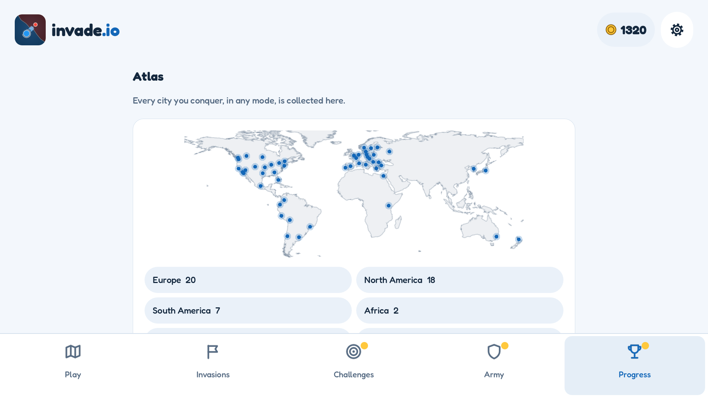

# Gameplay guide

[Documentation](README.md) · [Run locally](DEVELOPMENT.md) · [Platform support](PLATFORM_INTEGRATION.md)

invade.io is an offline, single-player territory strategy game. You control bases
on maps drawn from real-world geography, recruit troops, and decide where to
concentrate your forces. Gold and cosmetic rewards are earned by playing; there
are no ads or in-app purchases.

This guide describes the current source. Store versions may differ; see
[project status](README.md#project-status).

## Controls and battle goals

| Action | How it works |
|---|---|
| Send troops | Drag from a friendly base to another base and release. An order leaves one troop behind. |
| Combine forces | Drag through several friendly bases before releasing over the target. |
| Reinforce | Send troops to another friendly base. |
| Retreat | Start a swipe outside a friendly base and cut across one of your marching routes. |
| Inspect a base | Tap it to show its troops, capacity, production, and special properties. |
| Pause or adjust | Use the pause button for settings, help, and alternate battle controls. |

On desktop, mouse dragging emulates touch. The pause menu's alternate controls
let you select bases, send or recall troops, center the map, and adjust zoom
without relying on drag gestures.

Troops leave in successive packets, not all at once. Units still waiting to leave
are lost if their source falls; a retreat returns those waiting units to the
garrison. Opposing columns can fight en route. The target preview estimates the
defense on arrival, but cannot predict every collision or ownership change.

Normally, victory requires eliminating all enemy bases **and** marching troops;
neutral bases do not all need to be captured. Some daily challenges also offer a
hold-the-objective victory, explained before and during the battle. You lose when
you have neither bases nor troops left.

### Stars and medals

A victory earns one to three stars according to its simulation time. The briefing
and HUD show the three-star target; a victory within 1.5 times that target earns
two stars. Winning a campaign level without losing a base earns its mastery medal.

Game speed affects both sides. Records use simulation seconds, not wall-clock
time, and daily result cards include the speed and balance version. Do not treat
them as verified online rankings.

## Four ways to conquer

| Mode | Structure | Progression |
|---|---|---|
| Campaign | 30 levels across six continents; every fifth level has a boss | Unlock the next level, earn up to 90 campaign stars, and open regional invasions |
| Invasions | 36 regions, each with three sequential fronts | Finish a continent's campaign to unlock its regions; invasion stars are separate from campaign stars |
| Free conquest | Deterministically generated, five-region expeditions | Progress between regions is saved; each fifth region ends with a boss and double gold |
| Daily challenge | A locally generated map with rotating rules for the local calendar day | No combat upgrades; improve your personal record and copy a result card to share |

Daily challenges do not require a server and are not matches against other
players. Some rotate capital, factory, or fortress holding objectives. Their
records are compared only within the applicable balance version.

Invasions award gold for regional completion and an additional mastery reward
for earning three stars on all three fronts. Completing every region of a
continent unlocks its invasion army color.

## Bases and continent rules

Regular owned bases produce troops until full; neutral bases do not recruit.
Factories recruit faster but are easier to capture. Fortresses recruit slowly
and absorb more attacking force. Bosses receive periodic reinforcements while
held by their original enemy; their briefing states the amount and interval.

The first three campaign levels introduce the controls. Later campaign levels
use the continent's rule:

| Continent | Tactical rule |
|---|---|
| Europe | A marked capital provides 50% more production to its owner |
| North America | Neutral factories offer a recruitment advantage |
| South America | Jungle slows all marching troops by 20% |
| Africa | A marked oasis provides 75% more production |
| Asia | A neutral fortress guards the frontier |
| Oceania | Both player and AI must use the connected sea routes |

Expeditions and daily challenges rotate these rules. Invasions apply the rule of
their region, which may differ from its continent. For definitions and balance,
see [CampaignRules](../scripts/data/campaign_rules.gd) and
[LevelDatabase](../scripts/data/level_database.gd).

## Your army and collection

The main menu has five sections: **Play**, **Invasions**, **Challenges**, **Army**,
and **Progress**. Gold dots identify available rewards or an affordable combat
upgrade; rewards are claimed explicitly rather than through entry pop-ups.

- **Upgrades** improve starting garrison, recruitment, march speed, or gold
  rewards. Buying upgrades does not make the enemies scale with your purchases.
  Combat upgrades are disabled in daily challenges.
- **Cosmetics** change army colors, troop styles, base shapes, and map themes,
  not combat strength. Unlock them with earned gold, player ranks, or continent
  milestones.
- **Challenges** contains the daily reward, a streak that forgives one missed
  day, the daily challenge, and three daily missions with gold/XP rewards.
- **Progress** contains ranks, medals, invasion progress, the city atlas,
  continent collections, and 20 achievements. Player rank itself does not change
  combat strength.
- **The atlas** records cities you control when winning, in any mode. Continent
  collection rewards cover campaign cities, not every city in the geographic
  database. Replaying a cleared campaign level pays less unless you improve stars.

*A generated landscape capture with representative mid-game progress, not the
starting state of a new installation.*

## Language and accessibility settings

Settings includes 15 interface languages: English, Spanish, Brazilian Portuguese,
French, German, Italian, Russian, Turkish, Arabic, Hindi, Indonesian, Vietnamese,
Simplified Chinese, Japanese, and Korean. New games follow the device language
where supported; a saved language choice takes precedence. Arabic uses RTL
interface layout, but geographic maps and the brand are not mirrored.

You can change light/dark appearance, text size, a color-blind palette, reduced
motion, map contrast, game speed, sound/music volumes, and haptic feedback.
The interface theme and equipped map theme are separate choices.

These settings are not a claim of full mobile screen-reader compatibility. See
the [platform accessibility limitation](PLATFORM_INTEGRATION.md#accessibility).

## Saves, backups, and interruptions

Progress is saved automatically on the device. **Settings → Data** lets you
export a JSON backup, restore one after confirmation, retry a failed save, or
reset progress. Restore is unavailable during battle. Importing replaces local
progress and preserves the previous state in a backup; privacy choices are kept.

Leaving the app saves progress, suspends audio, and pauses battle until you choose
to resume. Closing the process does **not** preserve an unfinished battle.
Uninstalling or changing installation identifiers can remove access to local
progress: export a backup first. There is no cloud recovery.

## Offline play and privacy

All game modes work offline. Optional analytics and crash reporting use network
access when enabled; they are enabled by default in the current source, with
independent controls in **Settings → Privacy**. Existing choices are respected.
Offline gameplay does not mean that no data can be sent when connected. Read
[Telemetry and privacy](ANALYTICS.md) and the
[public privacy policy](https://macarronesc.github.io/invade.io/privacy-policy.html).
